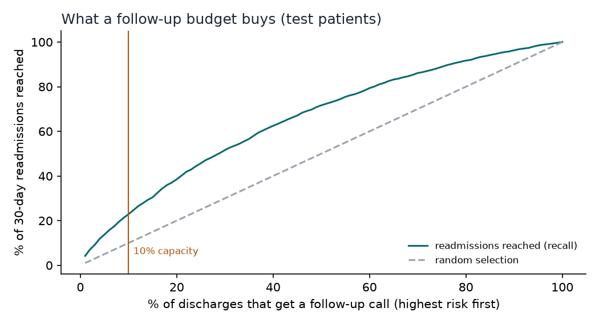

# Readmission Risk

Which diabetic hospital patients will be readmitted within 30 days? This project builds a risk model on **99,340 real hospital encounters from 69,987 patients** and evaluates it the way a hospital would need it evaluated:
- the data is split by patient, not by row;
- the probabilities are checked for calibration;
- the flag threshold is set by how many follow-up calls a team can make;
- the model is audited across race, sex, and age groups.

> **Status: learning project (September 2026).** It is built, tested, and run on real data, but I am still practising explaining it. This is **a study on 1999–2008 US hospital records, not a clinical tool**, and it should not be used to make decisions about patients.



## Headline results (held-out test patients, scored once)

| | Result |
|---|---|
| Ranking (ROC-AUC) | **0.673** [0.660, 0.686]. Logistic-regression baseline: 0.660 |
| Precision-recall AUC | 0.227, against an 11.4% base rate (about 2× chance) |
| Calibration | Average error **0.4 percentage points** across risk deciles |
| Calling the riskest 10% of discharges | Reaches **22.5%** of 30-day readmissions, with 26.5% of calls going to a patient who is readmitted: 2.3× better than calling at random |
| Subgroups | No large calibration gaps. Ranking is weaker for patients aged 70+ (0.650 vs 0.697 under 50) and African American patients (0.650 vs 0.678 Caucasian), with overlapping intervals |

**This is a hard prediction problem, and 0.67 is an honest score, not a disappointing one.** The two features that carry most of the signal are prior inpatient visits and discharge destination. Most of what drives a readmission (home support, follow-up care, adherence) is not in the data.

## A prediction I made and the data corrected

Before building this, I expected a row-level split to inflate the score badly, because about 16,000 patients have repeat encounters. When I measured it over 5 seeds, the row split put about 5,800 patients in both training and test but scored only **+0.004 ROC-AUC** higher (0.674 vs 0.670), which is within split-to-split noise. The patient split is still the correct design, but the leak turned out to be small here. There are two reasons:
- most patients have only one or two encounters;
- the gradient-boosting model won't create a leaf from fewer than 20 samples, so it can't memorise individual patients.

A synthetic test shows the same check *does* catch leakage when patients can be memorised.

## Quickstart

```bash
cd readmission-risk
python3 -m venv .venv && source .venv/bin/activate
python -m pip install -e '.[dev]'

python -m pytest -q tests          # 27 tests, offline

readmission download               # UCI archive, SHA-256 verified (~19 MB)
readmission run                    # select on validation, test once, audit -> outputs/ (~2 min)
```

Details: [docs/results.md](docs/results.md) and [docs/how-it-works.md](docs/how-it-works.md).

## Data

[UCI Diabetes 130-US Hospitals for Years 1999–2008](https://archive.ics.uci.edu/dataset/296), CC BY 4.0: 101,766 encounters, 50 columns, from 130 US hospitals. It was introduced by Strack et al. (2014).
