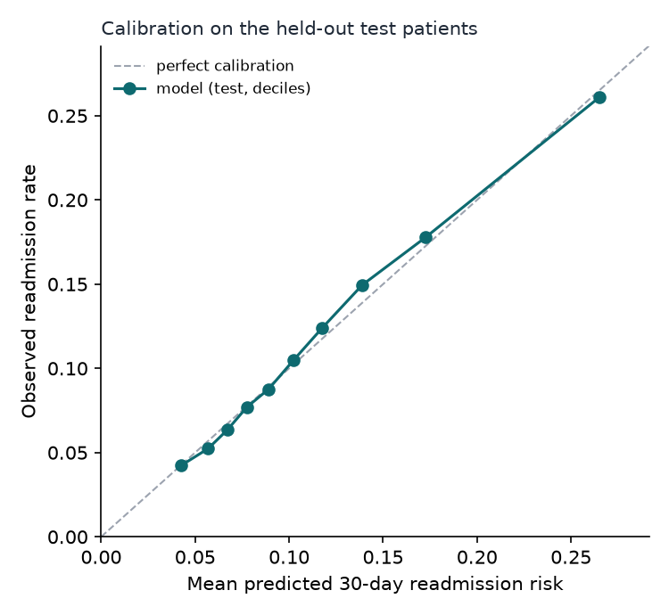
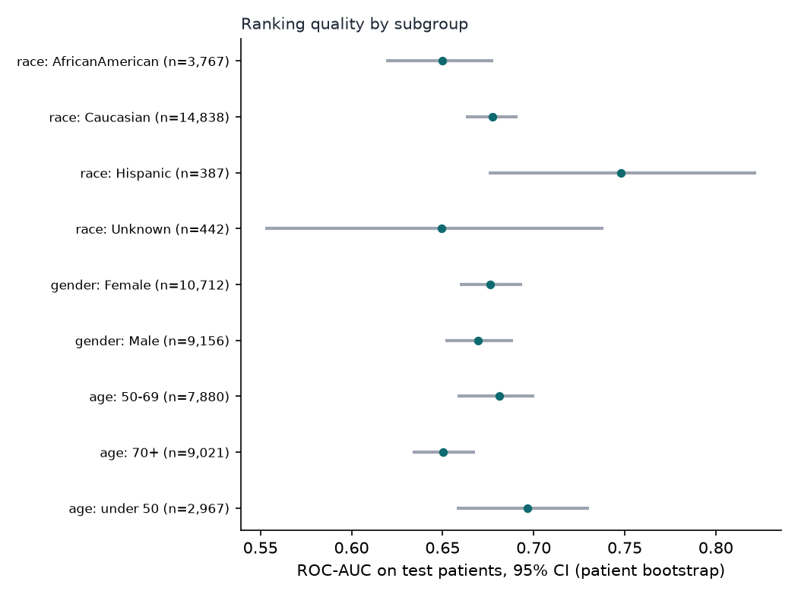

# Results — run of 2026-09-22

Every number comes from `readmission run` on the checksum-verified UCI files. Splits, models, and bootstraps use fixed seeds, so re-running reproduces them.

## 1. Cohort

| Step | Encounters | Patients | 30-day readmission |
|---|---:|---:|---:|
| All encounters | 101,766 | 71,518 | 11.16% |
| Minus discharges to death or hospice (codes 11, 13, 14, 19, 20, 21) | 99,343 | 69,990 | 11.39% |
| Minus 3 encounters with unknown gender (**modelling cohort**) | 99,340 | 69,987 | 11.39% |

Patients who died or went to hospice cannot be readmitted. Leaving them in would teach the model that some of the sickest patients are the "safest".

The split is 60/20/20 **by patient** (StratifiedGroupKFold). Train has 59,604 encounters, validation 19,868, and test 19,868, each with an 11.39% readmission rate. No patient appears in more than one split.

## 2. Model selection (validation only)

| Model | ROC-AUC | PR-AUC | Brier | Calibration error |
|---|---:|---:|---:|---:|
| **Gradient boosting, lr 0.05, 31 leaves** | **0.678** | **0.239** | 0.0955 | 0.0065 |
| Gradient boosting, lr 0.05, 15 leaves | 0.676 | 0.238 | 0.0956 | 0.0059 |
| Gradient boosting, lr 0.1, 31 leaves | 0.673 | 0.234 | 0.0957 | 0.0045 |
| Logistic regression, C = 1 | 0.663 | 0.222 | 0.0966 | 0.0061 |
| Logistic regression, C = 0.1 | 0.663 | 0.222 | 0.0966 | 0.0057 |

The model is selected on PR-AUC, because the positive class is only 11%. The gradient-boosting configurations are within 0.005 PR-AUC of each other, so the choice among them hardly matters. Their lead over logistic regression is small but consistent.

## 3. Test (scored once)

| | Gradient boosting | Logistic baseline |
|---|---:|---:|
| ROC-AUC | **0.673** [0.660, 0.686] | 0.660 |
| PR-AUC | 0.227 | 0.211 |
| Brier | 0.0962 | 0.0971 |
| Calibration error | 0.0039 | 0.0102 |

The ROC-AUC interval comes from resampling test **patients** (1,000 draws), not encounters.

Across all ten risk deciles, predicted risk matches the observed rate to within about one percentage point. The model's 4% predictions come true about 4% of the time, and its 26% predictions about 26% of the time.

## 4. Operating point: a follow-up budget

The threshold is set on **validation** so that the highest-risk 10% of discharges are flagged (score ≥ 0.198). On test:

| Flagged | Precision | Recall | Lift over random |
|---:|---:|---:|---:|
| 9.7% | 26.5% | 22.5% | 2.33× |

The whole curve on test, for other budgets:

| Budget | Readmissions reached | Precision | Lift |
|---:|---:|---:|---:|
| 5% | 13.7% | 31.3% | 2.75× |
| 10% | 22.9% | 26.1% | 2.29× |
| 20% | 38.5% | 21.9% | 1.93× |
| 30% | 51.6% | 19.6% | 1.72× |

These are the numbers someone deciding on staffing would actually use. For example, calling 30% of discharges reaches about half of the readmissions.

## 5. Subgroup audit (test)

Race is **not** a model feature. It is used only here, to check the model. Groups with fewer than 30 readmissions (Asian: 19, Other: 27) are listed in `outputs/subgroups.csv` without AUC or recall, because a few patients would swing those numbers.

| Group | Encounters | Observed | Predicted | Calibration gap | ROC-AUC [95% CI] | Recall at 10% budget |
|---|---:|---:|---:|---:|---:|---:|
| Caucasian | 14,838 | 11.6% | 11.3% | −0.2 pp | 0.678 [0.663, 0.691] | 22.8% |
| African American | 3,767 | 11.0% | 11.6% | +0.6 pp | 0.650 [0.619, 0.678] | 23.0% |
| Hispanic | 387 | 11.1% | 10.5% | −0.6 pp | 0.748 [0.675, 0.822] | 27.9% |
| Race unknown | 442 | 9.7% | 9.4% | −0.3 pp | 0.649 [0.553, 0.738] | 7.0% |
| Female | 10,712 | 11.2% | 11.5% | +0.3 pp | 0.676 [0.659, 0.694] | 23.7% |
| Male | 9,156 | 11.6% | 11.0% | −0.5 pp | 0.669 [0.652, 0.689] | 21.2% |
| Age under 50 | 2,967 | 9.8% | 10.1% | +0.3 pp | 0.697 [0.658, 0.730] | 31.0% |
| Age 50–69 | 7,880 | 10.5% | 10.9% | +0.4 pp | 0.681 [0.658, 0.701] | 23.9% |
| Age 70+ | 9,021 | 12.7% | 12.0% | −0.7 pp | 0.650 [0.634, 0.668] | 19.4% |

What I would say about this table:
- **Calibration** is within one percentage point for every reported group, so the risk numbers mean the same thing across groups.
- **Ranking is weaker for patients aged 70+** (0.650 [0.634, 0.668] vs 0.697 [0.658, 0.730] under 50). The intervals overlap only at their edges. This group also has the highest readmission rate, and a smaller share of its readmissions is reached at the 10% budget (19.4% vs 31.0%). If the model were used, this is the gap that would matter most, and it deserves a larger sample before anyone concludes it is real.
- **African American vs Caucasian:** 0.650 vs 0.678, with overlapping intervals and nearly identical recall. The difference may be real, but this sample cannot confirm it.
- **Race unknown:** 7.0% recall, but that is only 3 of 43 readmissions. Too few to conclude anything.

## 6. Leakage check

| Split design (5 seeds each) | Test ROC-AUC | Patients in both train and test |
|---|---:|---:|
| By patient (used) | 0.670 ± 0.005 | 0 |
| By row (wrong) | 0.674 ± 0.008 | about 5,769 |

The row split's advantage is **+0.004**, which is within the seed-to-seed spread. I expected a large inflation and did not find one. The patient split stays, because it is the right design regardless of how much it matters on this data. The small effect has two causes:
- 77% of patients (53,649 of 69,990) have a single encounter;
- the booster's 20-sample minimum leaf size prevents it from memorising individual patients.

A synthetic test (patients with 25 encounters and an identifying feature) confirms the check catches leakage when it exists: row split > 0.8, patient split < 0.6.

## 7. What drives the predictions

Permutation importance on **validation**, measured as the drop in PR-AUC when a feature is shuffled:

| Feature | Drop in PR-AUC |
|---|---:|
| number_inpatient (inpatient visits in the prior year) | 0.079 |
| discharge_disposition | 0.050 |
| medical_specialty | 0.006 |
| diag_1_group | 0.006 |
| payer_code | 0.005 |

Two features carry most of the signal. Prior hospital use predicting future hospital use is the most expected finding in readmission research, and it is also a reminder that the model mostly ranks *how often a patient is hospitalised*, not what goes wrong after discharge.

## Known limits

- The data is from 1999–2008. Care and coding have changed since, so nothing here says how the model would do today.
- One snapshot of 130 US hospitals, with no hospital identifier, so it cannot be tested on a hospital it hasn't seen.
- `payer_code` is a feature, and insurance type can act as a proxy for social factors. It adds little (0.005 PR-AUC). A deployed version should consider dropping it.
- The audit covers only the attributes the data records, and "race" is the dataset's own coarse categories.
